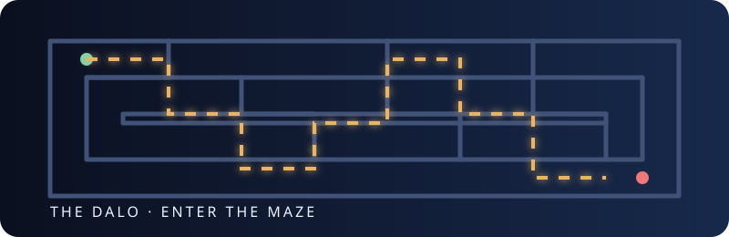

# ⟁ The DALO

### Deceptive Authentication Layer Orchestrator

> *Non tutti quelli che entrano nel labirinto cercano l’uscita.*

The DALO è un layer difensivo per osservare, classificare e contenere i tentativi automatizzati contro i sistemi di autenticazione.

Il nome richiama **Dedalo**, l’architetto del labirinto del Minotauro: quando una richiesta mostra un comportamento sospetto, The DALO può instradarla verso un percorso controllato, osservabile e progressivamente più costoso.

Il progetto è intenzionalmente **deterministico**: non utilizza modelli di intelligenza artificiale, non apprende autonomamente e non prende decisioni imprevedibili. A parità di segnali in ingresso, produce sempre lo stesso punteggio e lo stesso labirinto.


**Release corrente: `v0.1.0-alpha`** · [changelog](#versione-di-rilascio)

<p align="center"></p>

---

## Indice

- [Obiettivo](#obiettivo)
- [Caratteristiche](#caratteristiche)
- [Architettura](#architettura)
- [Installazione rapida](#installazione-rapida)
- [Configurazione](#configurazione)
- [Dashboard](#dashboard)
- [Endpoint di ingestione](#endpoint-di-ingestione)
- [Motore deterministico](#motore-deterministico)
- [I quattro labirinti](#i-quattro-labirinti)
- [Struttura del progetto](#struttura-del-progetto)
- [Test](#test)

## Obiettivo

The DALO nasce per proteggere endpoint di autenticazione, login amministrativi e risorse sensibili da:

- brute force;
- credential stuffing;
- enumerazione di endpoint;
- scanner automatizzati;
- riutilizzo di token;
- richieste con sequenze incompatibili con un client legittimo.

The DALO non cerca di dimostrare che una richiesta provenga da una “AI”. Analizza invece segnali osservabili e riproducibili: frequenza, errori, token, percorsi richiesti, user-agent e accessi a risorse esca.

## Che cosa fa

The DALO si colloca davanti o accanto al flusso di autenticazione. Per ogni richiesta raccoglie un evento normalizzato, calcola un punteggio di rischio e sceglie una risposta proporzionata:

```text
richiesta → segnali → punteggio → livello → labirinto → evento PostgreSQL
```

Il sistema non blocca automaticamente ogni errore e non presume che un singolo indirizzo IP sia sempre ostile. Una richiesta può essere normale, guardata con cautela, sottoposta a verifica oppure isolata in un percorso decoy. Questa gradualità riduce i falsi positivi e conserva informazioni utili per l’analisi.

<p align="center"></p>

## Caratteristiche

- Dashboard web per visualizzare gli eventi recenti.
- PostgreSQL come archivio centrale degli eventi e delle decisioni.
- Risk scoring deterministico e versionabile.
- Quattro labirinti di risposta: `specchio`, `arianna`, `minotauro` e percorso normale.
- Installer web per hosting condivisi.
- Configurazione cifrata con PHP Sodium.
- Rilevamento opzionale di `wp-config.php` per installazioni WordPress.
- Endpoint JSON per integrare The DALO con un middleware o un’applicazione esistente.
- Dati sintetici e sessioni decoy separabili dal sistema reale.

## Architettura

```text
                    ┌────────────────────┐
                    │ Applicazione reale │
                    │ login / API / CMS  │
                    └─────────┬──────────┘
                              │ evento
                              ▼
┌──────────────┐     ┌────────────────────┐     ┌──────────────────┐
│ Request      │────▶│ Risk Engine        │────▶│ Labyrinth Router │
│ Logger       │     │ regole determinist.│     │ risposta/policy  │
└──────────────┘     └─────────┬──────────┘     └────────┬─────────┘
                               │                         │
                               ▼                         ▼
                       ┌──────────────┐         ┌──────────────┐
                       │ PostgreSQL   │         │ Dashboard    │
                       │ eventi       │         │ osservabilità│
                       └──────────────┘         └──────────────┘
```

Il componente centrale è [`src/RiskEngine.php`](src/RiskEngine.php). Il motore riceve segnali normalizzati, assegna punti, calcola il livello di rischio e seleziona il labirinto.

## Installazione rapida

### Requisiti

- PHP 8.2 o superiore;
- estensione `pdo_pgsql`;
- estensione `sodium`;
- PostgreSQL 14 o superiore;
- Docker Compose opzionale per l’ambiente locale.

### Avvio locale con Docker

```bash
git clone https://github.com/tuo-account/thedalo.git
cd thedalo

docker compose up -d postgres
php -S 127.0.0.1:8080 -t public
```

Aprire:

```text
http://127.0.0.1:8080/
```

Al primo accesso, The DALO mostra l’installer se non trova una configurazione valida.

## Configurazione

Visitare:

```text
http://127.0.0.1:8080/setup.php
```

L’installer consente di inserire:

| Campo | Esempio |
|---|---|
| Host | `127.0.0.1` |
| Porta | `5432` |
| Database | `dalo` |
| Utente | `dalo` |
| Password | password dell’utente PostgreSQL |

Prima di salvare, l’installer:

1. verifica la connessione al database;
2. crea le tabelle definite in [`db/schema.sql`](db/schema.sql);
3. cifra la configurazione;
4. salva la chiave con permessi filesystem restrittivi.

Le credenziali non vengono hashate: un hash non può essere riutilizzato per aprire una connessione PostgreSQL. Vengono cifrate tramite `sodium_crypto_secretbox` e salvate in:

```text
config/.key
config/settings.enc
```

La cartella `config/` contiene anche un `.htaccess` che ne blocca l’accesso diretto quando il server usa Apache.

### WordPress

Se The DALO è collocato in una struttura simile a:

```text
wordpress/
├── wp-config.php
└── wp-content/
    └── plugins/
        └── thedalo/
```

l’installer cerca automaticamente `wp-config.php` nella root del progetto WordPress e nei percorsi parent comuni.

Il file viene letto soltanto per proporre host, porta, database e utente. Non viene modificato. Per sicurezza, la password non viene riproposta nel markup HTML: deve essere inserita esplicitamente nel form.

## Dashboard

La dashboard è disponibile sulla root dell’applicazione:

```text
http://127.0.0.1:8080/
```

Visualizza:

- richieste ricevute nelle ultime 24 ore;
- richieste sospette;
- sessioni instradate nel Minotauro;
- risk score medio;
- IP, metodo, percorso e status code;
- livello assegnato;
- labirinto selezionato.

La dashboard del MVP deve essere protetta prima dell’uso in produzione con autenticazione amministrativa e controllo CSRF.

## Endpoint di ingestione

`public/ingest.php` riceve un evento JSON e restituisce la decisione del motore.

```bash
curl -s http://127.0.0.1:8080/ingest.php \
  -H 'Content-Type: application/json' \
  -d '{
    "ip": "203.0.113.10",
    "method": "POST",
    "path": "/admin/config",
    "user_agent": "curl/8.0",
    "failed_auth_count": 8,
    "requests_last_minute": 80,
    "honeypot_hit": true,
    "session_hash": "demo-session"
  }'
```

Risposta esemplificativa:

```json
{
  "event_id": 1,
  "score": 140,
  "level": "critical",
  "labyrinth": "minotauro",
  "reasons": [
    {"points": 50, "reason": "ripetuti fallimenti di autenticazione"},
    {"points": 25, "reason": "frequenza elevata nell’ultimo minuto"},
    {"points": 25, "reason": "frequenza automatizzata molto elevata"},
    {"points": 40, "reason": "accesso a endpoint esca"}
  ]
}
```

L’endpoint è un nucleo di integrazione: il middleware dell’applicazione può usare il risultato per decidere se consentire l’accesso, applicare un ritardo, mostrare una challenge o aprire una sessione decoy.

## Motore deterministico

Il punteggio attuale usa regole esplicite:

| Segnale | Punti |
|---|---:|
| Almeno 3 fallimenti di autenticazione | fino a 50 |
| Almeno 20 richieste nell’ultimo minuto | 25 |
| Almeno 60 richieste nell’ultimo minuto | 25 aggiuntivi |
| CSRF assente o non valido | 20 |
| Token monouso riutilizzato | 30 |
| Endpoint honeypot raggiunto | 40 |
| User-agent automatizzato | 15 |
| Scansione di percorsi incoerenti | 10 |

| Score | Livello | Labirinto |
|---:|---|---|
| 0–29 | `normal` | `none` |
| 30–59 | `guarded` | `specchio` |
| 60–99 | `suspicious` | `arianna` |
| 100+ | `critical` | `minotauro` |

Le regole sono contenute in un singolo componente, possono essere sottoposte a test e possono essere estese senza introdurre un modello opaco.

## Metodologia decisionale

The DALO usa una metodologia a segnali cumulativi, composta da quattro fasi:

1. **Normalizzazione** — metodo, percorso, IP, user-agent, sessione e indicatori applicativi vengono trasformati in dati coerenti.
2. **Attribuzione dei punti** — ogni segnale verificato aggiunge un peso esplicito; i pesi non vengono adattati automaticamente.
3. **Classificazione** — il punteggio viene convertito in uno dei quattro livelli di rischio.
4. **Orchestrazione** — il livello seleziona il labirinto e la relativa policy.

Le decisioni sono spiegabili perché ogni risultato conserva le motivazioni (`reasons`) che hanno prodotto il punteggio. Il sistema segue tre principi:

- **proporzionalità**: un singolo segnale debole non porta direttamente al Minotauro;
- **componibilità**: segnali indipendenti possono aumentare il rischio insieme;
- **riproducibilità**: la stessa combinazione di input produce lo stesso risultato.

La scelta del labirinto è attualmente:

```text
0–29    normal      → none
30–59   guarded     → specchio
60–99   suspicious  → arianna
100+    critical    → minotauro
```

Questa è una policy iniziale, non una verità universale: in produzione i limiti devono essere tarati sul traffico reale, sul profilo degli utenti e sul costo operativo di ogni challenge.

## I quattro labirinti

### `none` — Il Cancello

Percorso normale. L’evento viene registrato e la richiesta può proseguire verso l’applicazione.

### `specchio`

Percorso per richieste guardate con cautela. Il sistema mantiene risposte controllate e logging più ricco. È il livello adatto per non penalizzare subito un utente legittimo.

### `arianna`

Percorso di verifica progressiva. È pensato per challenge, token monouso e controlli aggiuntivi collegati al middleware applicativo.

### `minotauro`

Percorso decoy per richieste critiche. Deve utilizzare esclusivamente dati sintetici, avere limiti di risorse e non poter raggiungere il database o i servizi reali.

## Struttura del progetto

```text
.
├── config/                 # configurazione cifrata e protezioni web
├── db/schema.sql           # schema PostgreSQL
├── assets/                 # illustrazioni SVG animate
├── benchmarks/             # benchmark riproducibili
├── public/
│   ├── index.php           # dashboard
│   ├── ingest.php          # endpoint JSON
│   └── setup.php           # installer
├── src/
│   ├── ConfigManager.php   # cifratura e caricamento config
│   ├── Dalo.php            # orchestrazione evento → decisione
│   ├── Database.php        # connessione PDO PostgreSQL
│   ├── RiskEngine.php      # scoring deterministico
│   └── WordPressConfig.php # rilevamento wp-config.php
├── tests/
│   └── RiskEngineTest.php
├── bootstrap.php
├── docker-compose.yml
└── composer.json
```

## Test

Eseguire i test del motore senza database:

```bash
php tests/RiskEngineTest.php
```

Controllare la sintassi di tutti i file PHP:

```bash
find . -type f -name '*.php' -print0 | xargs -0 -n1 php -l
```

## Benchmark

Il benchmark incluso misura il solo motore deterministico, senza rete, database o rendering HTML. In questo modo il dato è riproducibile e identifica il costo della decisione, non quello dell’infrastruttura.

Eseguirlo con:

```bash
php benchmarks/risk_engine.php 100000
```

Risultato misurato in questo ambiente con PHP 8.5.3:

```text
RiskEngine benchmark
iterations: 100000
score: 200
labyrinth: minotauro
elapsed_ms: 99.826
operations_per_second: 1001744
```

Il valore esatto dipende da CPU, versione PHP e carico del sistema. Per questo il repository include lo script e il comando, invece di considerare quei numeri una garanzia di produzione. Il benchmark non misura PostgreSQL, la rete o la latenza della dashboard.

## Versione di rilascio

### `v0.1.0-alpha`

Prima release pubblicabile del nucleo di The DALO:

- dashboard PostgreSQL;
- installer web;
- configurazione cifrata con Sodium;
- rilevamento di `wp-config.php`;
- endpoint JSON di ingestione;
- risk engine deterministico;
- quattro labirinti concettuali e routing iniziale;
- test automatici del motore;
- asset SVG animati per documentazione e interfacce.

La release è **alpha**: il nucleo è eseguibile, ma autenticazione amministrativa, middleware completo e isolamento operativo del Minotauro devono essere completati prima dell’esposizione a traffico reale.

## Licenza

La licenza non è ancora stata definita. Prima di distribuire il progetto, aggiungere un file `LICENSE` con i termini scelti.

---

<p align="center"><i>Lascia che il labirinto protegga il cuore della tua applicazione.</i></p>
